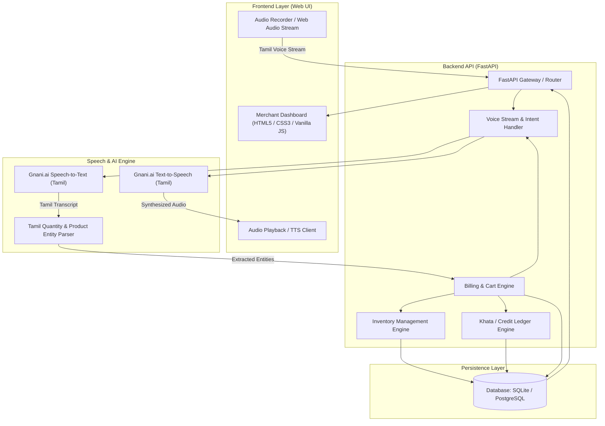

# TamilVoice Kirana AI (தமிழ் வாய்ஸ் கிரானா AI)

> An intelligent, voice-first billing, inventory management, and digital ledger (Khata) solution purpose-built for Kirana and retail store merchants in Tamil Nadu, powered by Tamil Natural Language Processing and speech recognition.

---

## 📌 Project Overview

**TamilVoice Kirana AI** bridges the technology gap for traditional Indian retail merchants by enabling hands-free, bilingual (Tamil & English) operational management. Small grocery and retail shop (Kirana) owners frequently juggle high-frequency foot traffic, manual ledger books (*khata*), and complex computerized Point of Sale (POS) systems that require extensive typing in English.

With TamilVoice Kirana AI, store owners can simply speak in colloquial Tamil (e.g., *"ரெண்டு கிலோ பொன்னி அரிசி, ஒரு பாக்கெட் ஆச்சி மிளகாய் தூள் பில் போடு"* — *"Add 2 kg Ponni rice, 1 packet Aachi chilli powder to bill"*), and the system automatically parses items, units, quantities, prices, updates inventory, and generates instant invoices.

---

## ⚠️ Problem Statement

1. **Language & Interface Friction**: Existing ERP and billing software cater almost exclusively to English-literate users with desktop keyboard-and-mouse workflows, slowing down fast-paced Kirana counters.
2. **Peak-Hour Billing Bottlenecks**: During rush hours, typing item names and looking up barcodes creates long customer queues and lost sales.
3. **Manual Khata & Credit Tracking**: High volume of credit transactions (*udhaar*) recorded in paper notebooks leads to uncollected balances, disputed amounts, and zero automated reminders.
4. **Inventory Stockout & Spoilage**: Lack of real-time stock monitoring causes unexpected stockouts or overstocking of perishables.

---

## 🚀 Key Features (Planned & Under Development)

- **Tamil Speech-to-Billing Engine**: Natural voice commands in conversational Tamil for lightning-fast cart addition, item edits, and bill finalization.
- **Bilingual & Colloquial Tamil NLP**: Accurate parsing of regional units (*கிலோ, கிராம், பாக்கெட், லிட்டர், படி*) and colloquial product terminology.
- **Intelligent Inventory & Stock Alerting**: Automated real-time inventory adjustments with low-stock warnings and re-order insights.
- **Digital Khata (Customer Credit Ledger)**: Track customer-wise debt balances, voice-logged payments, and automated reconciliation.
- **Bilingual Audio Confirmation (Text-to-Speech)**: Audio feedback in Tamil confirming billing actions and order totals.
- **Fast, Responsive Merchant Dashboard**: Clean, lightweight web interface optimized for desktops, tablets, and low-cost POS terminals.
- **Daily Analytics & Business Intelligence**: Summary of total sales, cash vs. credit split, top-selling items, and margin insights.

---

## 🛠️ Technology Stack

| Layer | Technologies |
| :--- | :--- |
| **Frontend** | Semantic HTML5, CSS3 (Custom responsive styling, theme support), Vanilla JavaScript (ES6+), Web Audio API |
| **Backend** | Python 3.10+, FastAPI (high-performance asynchronous REST API), Pydantic, Uvicorn |
| **Voice & Speech AI** | Gnani.ai Speech APIs (Tamil ASR & TTS), Web Speech API fallback, custom NLP tokenizer |
| **Database & ORM** | SQLite (Development) / PostgreSQL (Production), SQLAlchemy, Alembic |
| **Version Control & CI/CD** | Git, GitHub |

---

## 🏛️ Architecture Overview



---

## 🗺️ Development Roadmap

- [x] **Phase 1: Project Initialization & Git Architecture Setup**
  - Workspace inspection, branch standardisation (`main`), repository remote linkage, `.gitignore`, and engineering structure.
- [x] **Phase 2: Advanced Voice Assistant Frontend & Design System**
  - Responsive, modern merchant dashboard using semantic HTML5, CSS3, and Vanilla JavaScript.
  - Interactive billing register, voice trigger interface, waveform audio recording, and demo voice commands.
- [x] **Phase 3: Advanced Inventory & Sales Management UI**
  - Real-time inventory table with stock adjustment modal, SKU filtering, low-stock warnings, and retail sales checkout flow.
- [x] **Phase 4: FastAPI Backend & SQLite Database Engine**
  - Asynchronous REST API, SQLAlchemy 2.x declarative models, Alembic migrations, foreign key PRAGMA enforcement, and database seeder.
- [x] **Phase 5: Google Gemini AI Tamil & Tanglish Intelligence Engine**
  - Natural language intent extraction (`ADD_STOCK`, `SELL_PRODUCT`, `CHECK_STOCK`, `LOW_STOCK_QUERY`, `SALES_REPORT`), bilingual Tamil/Tanglish synonym resolution, and 2-step confirmation workflow.
- [x] **Phase 6: Gnani Prisma v2.5 STT + Gnani Timbre v2.5 TTS Integration**
  - Full end-to-end voice pipeline: Browser microphone recording → Gnani Prisma v2.5 speech-to-text → Gemini intent extraction → SQLite product lookup → Confirmation preview → User confirmation → SQLite commit → Gnani Timbre v2.5 speech synthesis → Browser audio playback.
  - Deterministic Kirana mock transcription and pure-Python 16-bit PCM WAV synthesizer fallbacks.
  - 16-state voice conversation state machine in frontend.
  - 56 automated tests with 100% pass rate.

---

## ⚙️ Installation & Local Setup

### Prerequisites

- Git
- Python 3.10 or higher
- Modern web browser (Chrome, Edge, Firefox)

### 1. Clone the Repository

```bash
git clone https://github.com/Jeeva1117/TamilVoice-Kirana-AI.git
cd TamilVoice-Kirana-AI
```

### 2. Configure Environment

Copy the example environment template in `backend/`:

```powershell
cd backend
cp .env.example .env
```

Configure `.env` with your settings:

```env
# Application Settings
PROJECT_NAME="TamilVoice Kirana AI"
VERSION="1.0.0"
API_PREFIX="/api"
DATABASE_URL="sqlite:///./kirana_ai.db"
TIMEZONE="Asia/Kolkata"
DEBUG=true

# Google Gemini AI (Official Google GenAI SDK)
GEMINI_API_KEY=your_gemini_api_key_here
GEMINI_MODEL=gemini-2.5-flash
GEMINI_ENABLED=true
GEMINI_TIMEOUT_SECONDS=15.0

# Gnani.ai Indic Voice Platform (Prisma STT & Timbre TTS)
GNANI_API_KEY=your_gnani_api_key_here
GNANI_STT_MODEL=prisma-v2.5
GNANI_TTS_MODEL=timbre-v2.5
GNANI_STT_ENABLED=true
GNANI_TTS_ENABLED=true
GNANI_API_BASE_URL=https://api.vachana.ai
GNANI_STT_TIMEOUT=30.0
GNANI_TTS_TIMEOUT=30.0
MAX_AUDIO_SIZE_BYTES=10485760
```

> **Demo / Mock Note:** When `GNANI_API_KEY` or `GEMINI_API_KEY` are not provided, the application gracefully operates in mock/demo mode with synthetic Tamil speech and realistic Kirana command samples.

### 3. Backend Setup & Server Launch (Windows PowerShell)

```powershell
# From the project root
python -m uvicorn backend.app.main:app --host 127.0.0.1 --port 8000 --reload
```

Interactive API documentation:
- **Swagger UI:** `http://127.0.0.1:8000/docs`
- **ReDoc:** `http://127.0.0.1:8000/redoc`

### 4. Frontend Launch

In a second terminal window, serve the frontend:

```powershell
# From the project root
python -m http.server 3000 --directory frontend
```

Open in browser:
- `http://localhost:3000`

### 5. Running Automated Tests

Run the full Pytest test suite covering all Phases 1–6 (56 tests):

```powershell
python -m pytest backend/tests -v
```

---

## 📊 Current Project Status

- **Status**: **Phase 6 Complete — Gnani Prisma v2.5 STT & Timbre v2.5 TTS Full Integration**
- **Active Branch**: `main`
- **Automated Tests**: 56 passing (100% pass rate)
- **Voice Pipeline**: End-to-end live Tamil/Tanglish speech-to-text, Gemini intent extraction, safe confirmation workflow, and synthesized Tamil voice playback.

---

## 📄 License

This project is licensed under the MIT License — see the LICENSE file for details (to be added).

