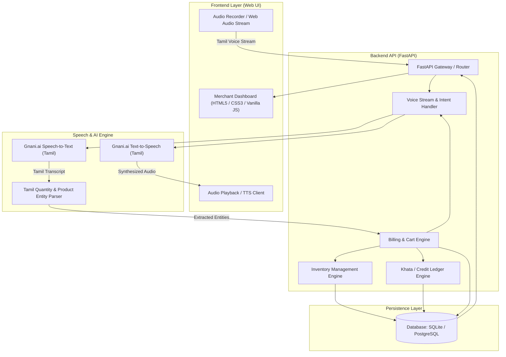

# TamilVoice Kirana AI (தமிழ் வாய்ஸ் கிரானா AI)

> An intelligent, voice-first billing, inventory management, and digital ledger (Khata) solution purpose-built for Kirana and retail store merchants in Tamil Nadu, powered by Tamil Natural Language Processing and speech recognition.

---

## 📌 Project Overview

**TamilVoice Kirana AI** bridges the technology gap for traditional Indian retail merchants by enabling hands-free, bilingual (Tamil & English) operational management. Small grocery and retail shop (Kirana) owners frequently juggle high-frequency foot traffic, manual ledger books (*khata*), and complex computerized Point of Sale (POS) systems that require extensive typing in English.

With TamilVoice Kirana AI, store owners can simply speak in colloquial Tamil (e.g., *"ரெண்டு கிலோ பொன்னி அரிசி, ஒரு பாக்கெட் ஆச்சி மிளகாய் தூள் பில் போடு"* — *"Add 2 kg Ponni rice, 1 packet Aachi chilli powder to bill"*), and the system automatically parses items, units, quantities, prices, updates inventory, and generates instant invoices.

---

## ⚠️ Problem Statement

1. **Language & Interface Friction**: Existing ERP and billing software cater almost exclusively to English-literate users with desktop keyboard-and-mouse workflows, slowing down fast-paced Kirana counters.
2. **Peak-Hour Billing Bottlenecks**: During rush hours, typing item names and looking up barcodes creates long customer queues and lost sales.
3. **Manual Khata & Credit Tracking**: High volume of credit transactions (*udhaar*) recorded in paper notebooks leads to uncollected balances, disputed amounts, and zero automated reminders.
4. **Inventory Stockout & Spoilage**: Lack of real-time stock monitoring causes unexpected stockouts or overstocking of perishables.

---

## 🚀 Key Features (Planned & Under Development)

- **Tamil Speech-to-Billing Engine**: Natural voice commands in conversational Tamil for lightning-fast cart addition, item edits, and bill finalization.
- **Bilingual & Colloquial Tamil NLP**: Accurate parsing of regional units (*கிலோ, கிராம், பாக்கெட், லிட்டர், படி*) and colloquial product terminology.
- **Intelligent Inventory & Stock Alerting**: Automated real-time inventory adjustments with low-stock warnings and re-order insights.
- **Digital Khata (Customer Credit Ledger)**: Track customer-wise debt balances, voice-logged payments, and automated reconciliation.
- **Bilingual Audio Confirmation (Text-to-Speech)**: Audio feedback in Tamil confirming billing actions and order totals.
- **Fast, Responsive Merchant Dashboard**: Clean, lightweight web interface optimized for desktops, tablets, and low-cost POS terminals.
- **Daily Analytics & Business Intelligence**: Summary of total sales, cash vs. credit split, top-selling items, and margin insights.

---

## 🛠️ Technology Stack

| Layer | Technologies |
| :--- | :--- |
| **Frontend** | Semantic HTML5, CSS3 (Custom responsive styling, theme support), Vanilla JavaScript (ES6+), Web Audio API |
| **Backend** | Python 3.10+, FastAPI (high-performance asynchronous REST API), Pydantic, Uvicorn |
| **Voice & Speech AI** | Gnani.ai Speech APIs (Tamil ASR & TTS), Web Speech API fallback, custom NLP tokenizer |
| **Database & ORM** | SQLite (Development) / PostgreSQL (Production), SQLAlchemy, Alembic |
| **Version Control & CI/CD** | Git, GitHub |

---

## 🏛️ Architecture Overview



---

## 🗺️ Development Roadmap

- [x] **Phase 1: Project Initialization & Git Architecture Setup**
  - Workspace inspection, branch standardisation (`main`), repository remote linkage, `.gitignore`, and engineering structure.
- [ ] **Phase 2: Frontend Dashboard Interface**
  - Responsive, modern merchant dashboard using HTML5, CSS3, and Vanilla JavaScript.
  - Interactive billing register, voice trigger interface, product lookup, and khata ledger cards.
- [ ] **Phase 3: FastAPI Backend & Data Models**
  - Asynchronous REST endpoints for products, billing, inventory, and customer ledger.
  - Database schema and ORM layer.
- [ ] **Phase 4: Tamil Speech & NLP Pipeline**
  - Integration with Gnani.ai ASR and TTS APIs.
  - Tamil entity extraction (product name, numerical count, standard units).
- [ ] **Phase 5: Real-Time Business Logic & Analytics**
  - Voice-driven end-to-end checkout, credit reconciliation, and daily sales analytics.
- [ ] **Phase 6: Testing, Hardening & Deployment**
  - Unit/integration testing, offline-first resiliency, and production deployment configuration.

---

## ⚙️ Installation & Local Setup

### Prerequisites

- Git
- Python 3.10 or higher
- Modern web browser (Chrome, Edge, Firefox)

### 1. Clone the Repository

```bash
git clone https://github.com/Jeeva1117/TamilVoice-Kirana-AI.git
cd TamilVoice-Kirana-AI
```

### 2. Configure Environment

Copy the example environment template:

```bash
cp .env.example .env
```

Update `.env` with your local settings and API keys.

### 3. Backend Setup (Upcoming)

```bash
# Create and activate virtual environment
python -m venv venv
# On Windows:
venv\Scripts\activate
# On Linux/macOS:
source venv/bin/activate

# Install dependencies (once requirements.txt is available)
pip install -r backend/requirements.txt

# Run FastAPI server
uvicorn backend.main:app --reload --port 8000
```

### 4. Frontend Launch

Open `frontend/index.html` in your web browser or serve it using any local static file server (e.g., Live Server or Python HTTP server):

```bash
python -m http.server 3000 --directory frontend
```

---

## 📊 Current Project Status

- **Status**: **Phase 1 Complete — Repository Setup & Project Initialization**
- **Active Branch**: `main`
- **Next Milestone**: Phase 2 — Implementation of the responsive merchant dashboard UI in HTML, CSS, and Vanilla JavaScript.

---

## 📄 License

This project is licensed under the MIT License — see the LICENSE file for details (to be added).
